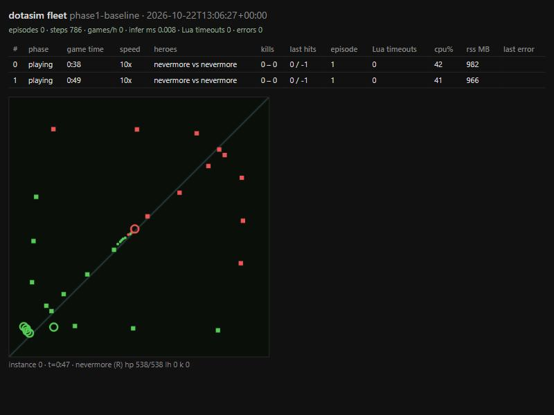

# Experiment log

One entry per run. Newest at the bottom. Numbers come from the run's `status.json` or the CLI's printed totals.

## 2026-10-22 Phase 1 fleet baseline

Setup: 12 headless Linux servers in WSL2 (Ubuntu 26.04, 16 GB allotted), Dota 2 build 6965, mode 21, Shadow Fiend mirror, both heroes Valve default AI (difficulty cvar 4), host_timescale 10, 10 frames per worldstate, 600 game-second cap, no policy inference.

Command: `python -m dotasim.train.rollout --instances 12 --episodes 1 --policy valve --run runs/phase1-baseline`

| metric | value |
|---|---|
| episodes | 12 (all reached the 600 s cap) |
| worldstate steps | 24,421 |
| wall time | 112.8 s (includes staggered launch, 3 s apart) |
| games per hour | 383 |
| aggregate speed | about 72x real time (24,421 steps x 0.333 s / 112.8 s) |
| per instance | about 6 to 8x real time while all 12 run; 10x alone |
| Lua timeouts | 0 |
| errors | 0 |

Observations:
- A Valve-vs-Valve SF mirror rarely ends inside 10 game minutes; in a 30-minute run it ended 1-1 at exactly 30:00, which looks like a mode 21 time limit.
- At POST_GAME the server stops streaming worldstates and keeps the socket open for a few seconds before closing. The env detects the end from the console log.
- Memory: 12 instances fit in the default 16 GB WSL2 allotment with about 2 GB spare after map loads. No `.wslconfig` change was needed.
- Random-policy inference (two instances, 200 steps each): p95 under 0.01 ms. The per-decision budget at 10x and 10 frames is 33 ms, so a 3M-parameter CPU forward pass has room; batching across instances stays deferred.

Verdict: harness exit criteria met. Decision interval, batching and a real model are phase 2 questions.

Rerun with SourceTV recording on every instance (the shipped default after the live-view work, `runs/phase1-baseline-tv`): 12 episodes, 24,773 steps, 132.6 s wall, 326 games per hour, about 62x aggregate, 0 Lua timeouts. Recording costs roughly 15% throughput and writes about 8 MB per 10-minute game into `~/dota2/game/dota/replays/`; a retention policy is a phase 3 item before thousand-episode runs.

## 2026-10-22 Live view: spectating a WSL2 server from the Windows client

Goal: watch a running training game with the real client instead of the canvas minimap.

| attempt | server flags | client | result |
|---|---|---|---|
| direct connect | `+sv_lan 1`, no lobby | `+connect 172.21.211.69:27015` | handshake completes, server rejects with `NETWORK_DISCONNECT_REJECT_NOLOBBY` |
| SourceTV | `+tv_enable 1 +tv_port 28000 +tv_delay 0` | `+connect 172.21.211.69:28000` | connects, reaches level load, dropped with `NETWORK_DISCONNECT_BADRELAYPASSWORD` |
| SourceTV + password | above plus `+tv_password dotasim +tv_relaypassword dotasim` | `+password dotasim +connect ...:28000` | connects, dropped with `NETWORK_DISCONNECT_INVALID` |

Networking between the Windows client and the WSL2 server works (challenge and connect exchanged on UDP 27015 and 28000, no firewall change needed). The rejection is the game's lobby and TV policy, not the network. Time-boxed to three attempts; live spectating is deferred. The canvas minimap on the status page stays the live view, and a Windows instance launched without `-dedicated` is the rendered debugging option.

SourceTV auto-recording works on the dedicated server: `~/dota2/game/dota/replays/auto-<date>-start-Dota_2.dem` (about 7 MB for 2 minutes at 10x). The server keeps `+tv_enable 1 +tv_autorecord 1 +tv_delay 0 +tv_port 28000+i`; the TV password flags were dropped.

Replay playback verified: copying the server's `.dem` into the Windows client's `game/dota/replays/` and launching with `+playdemo replays/<file>.dem` plays it with the real UI (reached PRE_GAME in the client log). That is the "watch what it learned" path for the writeup.

## 2026-10-23 Phase 2 dataset: sf_mirror_v1

Valve unfair vs Valve unfair, Shadow Fiend mirror, mode 21, 5 frames per worldstate (0.167 s), 600 s cap, both teams' views recorded with observer stats (last hits, denies, gold, net worth, level per hero).

| metric | value |
|---|---|
| games | 24 requested, 23 recorded (1 lost to a dropped stream) |
| files | 46 (one per team per game) |
| steps | 180,502 |
| size | 1.4 GB raw zlib-compressed worldstates |
| recording wall | 7.6 min on 8 instances (188 games/h) |

Lesson: recording on 12 instances at 5 frames with both teams watched dropped most streams. The game closes a worldstate socket the moment its reader stalls, and the episode-end save (recompressing 40 MB on the event loop) stalled every other instance for seconds. Per-frame zlib in a thread pool and plain `np.savez` in a worker fixed it.

Label mix over the first four episodes (Valve SF): none 34%, move 58%, attack 8%, casts under 1%. The Valve bot's current order is `MOVE_TO_TARGET` more often than `MOVE_TO_POSITION`; both label as moves from displacement.

## 2026-10-23 Phase 2 cloning: bc_v1

Trained on sf_mirror_v1 (46 episode files, 179,754 labeled steps), 12 epochs, batch 32 windows of 32 steps, lr 3e-4, 8 CPU threads: 100.7 min.

| metric | value |
|---|---|
| type loss | 1.80 -> 0.59 |
| type accuracy (teacher-forced, whole set) | 81.0% (majority class "move" 57.1%) |
| attack-target accuracy | 95.2% |
| label mix | none 33%, move 57%, attack 9%, razes 0.4%, requiem 0 |

Live evaluation, SF vs Valve passive, 5 game-minutes, 3 games, 3 instances (`runs/eval_bc_v1_passive`, `runs/eval_random`):

| policy | median last hits | median level | deaths | Valve bot's own last hits |
|---|---|---|---|---|
| random (move/attack nearest creep) | 0 | 1 | 0 | 20 |
| bc_v1 greedy | 0 | 1 | 0 | 20 |
| bc_v1 sampled | 0 | 2 | 1 | 8 |

Verdict: **phase 2 exit (median >= 5 last hits) not met.** Offline the clone reproduces the recorded action mix per
time bucket almost exactly, so the model learned the marginals; live it fails two ways. Greedy decoding repeats one
move direction every step and the hero walks into the base cliff at (-5280, -864) and never moves again. Sampled
decoding does reach the lane sometimes (46 attack orders and a last hit in a diagnostic game) but random-walks across
the map, because single-step displacement direction labels are noisy at 0.167 s. Two fixes are queued: direction and
distance labels from the 1-second lookahead (smoother intent), and action repeat for moves. Both need a re-record of
the feature cache and a retrain (about 2 hours), so they are deferred behind the self-play run, which optimizes laning
directly through shaping and uses bc_v1 only as a prior and KL anchor. Evaluation now samples by default.

## 2026-10-23 Phase 3 self-play: first attempt stopped, loop fixed, restarted

`runs/sp_v0_buggy` (3 iterations, 12 servers, 300 s episodes): about 30k steps per iteration where two trajectories per
episode should give about 43k, and 2 to 6 outcomes recorded out of 12 games. A fresh-context review found why: after
`DotaEnv.step` became alternating per team, the collector only closed the trajectory of the team that happened to be
in the step's obs, credited each shaped reward one step late, and read the winner from a stale worldstate, so finished
games fell into the cap-bootstrap path. Fixed by holding each live team's decision as pending until that team's next
worldstate arrives, closing both teams at episode end against the newest state, bootstrapping capped episodes from
V(s_T+1), and making the post-game flag mean what it says. A new game test pins it: one self-play episode yields two
trajectories of equal length whose stored rewards equal `step_reward` over that team's consecutive worldstates.

Throughput with 12 servers and batched inference on this 8-core machine: about 3x real time per server (CPU bound by
the servers themselves; feature extraction costs 0.16 ms), 18 ms per batched decision, an iteration of twelve 5-minute
games in 60 to 80 s of rollout plus about 75 s of PPO update (2 epochs, minibatch 64).

`runs/sp_v1` restarted from `bc_v1` with the fixed loop: 80 iterations, eval every 10 (6 games vs unfair, 6 vs passive).

Two more restarts before the run was sound. First: the killed run's servers were still shutting down when the next
run launched, so the first wave collided on ports for five iterations (`runs/sp_v1_dirtystart`). Second: with the live
policy on 8 torch threads next to 12 servers on 16 logical CPUs, a batched decision took 200 to 660 ms instead of 18,
every Lua wait timed out, the game clock crawled at 0.1x and the server ended games while still in pre-game
(`runs/sp_v1_threads8`). Rollouts now use 4 threads and the update 8. The clean run (`runs/sp_v1`): iteration 2 =
42,876 steps, 24 trajectories, 4.0x per server, 16.9 ms per decision, 0.2% Lua timeouts, 0 errors.

Two further collapse mechanisms found and fixed in the same hour (each cost a restart; `runs/sp_v1_contaminated`,
`runs/sp_v1` first four iterations): (a) a server exiting from the previous iteration writes its POST_GAME line into
the console log the new server of the same index just truncated, so the new instance believed its game had ended at
the first stream hiccup; the instance now ignores post-game lines seen before its own Lua handshake, and the loop
waits for every old server to exit before launching or evaluating; (b) the first servers of a wave were stepping
while the other nine loaded maps, got starved past the 5 s read timeout and lost their episodes; the fleet now waits
for the whole wave to reach pre-game before the first step, and the read timeout is 15 s. `runs/sp_v2` continues
from the fourth sp_v1 checkpoint (three clean iterations) with all guards.

And a third (`runs/sp_v2`, iterations 4 and 5): the replay pruner kept the newest 30 demos, twelve servers write
one per episode, so from the fourth iteration each launch deleted the oldest demos, among them recordings that servers
launched seconds earlier in the same wave were still writing, and the server ends a game whose recording vanishes. Those
iterations showed about 2,000 steps, no errors and games "ending" in pre-game. The pruner now leaves any demo modified
in the last ten minutes alone. `runs/sp_v3` continues from the sixth sp_v2 checkpoint.

Correction: the iteration-4/5/7 collapses were not the pruner (the fix above is still right, but `runs/sp_v3` collapsed
at the same iterations with it). The league's seeded sampler assigns the same matchup kinds every run, and the real
cause was mixing kinds within a wave: every server's reset rewrites the shared `bots/config.lua`, so servers launched
after a "valve" reset got a team 3 controlled in Lua that Python never fed, and those games stalled. The spec said one
kind per wave; the loop now samples one league kind per iteration. `runs/sp_v4` continues from the seventh sp_v3
checkpoint.

## 2026-10-23 Phase 3 self-play: sp_v4 (stopped at the user's request)

`runs/sp_v4`, 12 servers, 300 s episodes, one league kind per wave, continuing from sp_v3. Iterations 1 to 5 are the
first fully healthy self-play iterations of the project: 26,700 to 36,000 steps each, all 24 trajectories, 3.7 to
4.2x per server, 16 to 23 ms per batched decision, 31 to 52 Lua timeouts per iteration (about 0.1%), zero errors.
Value loss fell from 0.0061 to 0.0041, KL to the anchor rose from 0.017 to 0.042, entropy 0.35 to 0.39. Every game
was a draw: in 5-minute episodes two Shadow Fiend clones that barely lane do not kill each other or a tower.
Iterations 6 to 9 ran while a game (Deadlock) was played on the same machine: decisions took 350 to 935 ms, Lua
timeouts jumped and the game clock fell to 0.1x; those updates are on little data. The run was stopped at iteration 9.
No evaluation was reached (first scheduled at iteration 10). Best clean checkpoint: `runs/sp_v4/pool/it0005.pt`;
latest: `runs/sp_v4/policy.pt`.

Phase 3 exit (50% vs unfair) not met; the loop is correct and measured, the agent has had about 25 clean minutes of
self-play in total. Resume with `--init runs/sp_v4/pool/it0005.pt` on an idle machine.

## 2026-10-23 Phase 2 retry: bc_v2 (lookahead labels, stateful BC)

Two changes against the live failure of bc_v1, both from the phase 2 diagnosis and the review's train/serve skew point:

- Move labels now take direction and distance from the displacement 6 steps (1 s) ahead; below 100 units is "none",
  above 1500 (respawn, teleport) is "none". Measured on one episode the gain is small: consecutive move steps share a
  direction bin 77% of the time versus 75% with single-step labels, and the move share drops from 71% to 58% (idle
  jitter stops counting as walking). So the "noisy labels" half of the diagnosis was overstated.
- The trainer carries the GRU state across an episode's windows (episodes as 16 parallel streams, state detached
  between 32-step windows). bc_v1 trained every window from the zero state and then served thousands of steps from one
  carried state; the states it saw live were ones it had never been trained on. This is the stronger candidate.

Feature cache: `data/sf_mirror_v1/cache_f5_v2` (label version in the name).

Training speed: bc_v1's 8.4 min per epoch was disk time, not compute. `np.load` on an npz is lazy and every window
access re-read whole arrays from `/mnt/c`; the process sat in disk wait at 30% of one core. Holding the 559 MB cache
in RAM makes an epoch 142 s on 8 threads (3.5x), so bc_v2's 8 epochs take 20 minutes, not 100.

bc_v2 result (8 epochs, 19 min, 2,269 updates): type accuracy 73% vs a 60% majority rate (labels changed, so not
comparable with bc_v1's 81%), attack-target accuracy 91%.

Live evaluation, SF vs Valve passive, 5 game-minutes, 3 games (`runs/eval_bc_v2_passive`):

| policy | last hits per game | median | median level | deaths |
|---|---|---|---|---|
| random | 0, 0, 0 | 0 | 1 | 0 |
| bc_v1 sampled | 0, 0, 0 | 0 | 2 | 1 |
| bc_v2 sampled | 3, 4, 6 | **4** | 4 | 1 |

Verdict: the clone lanes. Median 4 is one short of the phase 2 exit (5), so the xfail stays with an updated reason,
but this is the first live sign the pipeline works end to end. Given that the label change barely moved consistency,
the GRU train/serve skew was the main cause of bc_v1's failure. Self-play restarts from bc_v2 as `runs/sp_v5`.
Open: 50 to 170 Lua attack mismatches per game (attack orders on units the Lua side could not find), worth a look.

## 2026-10-25 Phase 3: sp_v5 from bc_v2, and two findings on the way

First launch (right after a WSL restart, cold page cache): iterations 1 and 2 ended every game about 10 s before
the horn with 5k to 10k steps, decisions at 220 to 500 ms. Stopped, discarded. Added `info["end"]` (cap,
post_game_state, post_game_log, stream_timeout, stream_eof) and an `ends` count per iteration in the log so this is
never a guess again. The relaunch was healthy from iteration 1: 40,744 steps, 24 trajectories, 50 timeouts,
7.2 last hits per game (the clone alone gets 4 vs passive bots).

Every one of those 12 games ended `post_game_log`, yet all were recorded as draws. The eval files explain it: every
finished game had exactly one death (ended at 89, 120, 187, 198 s), so on this build the 1v1 ends at the first hero
death, while `winner()` demanded two kills. That is why sp_v4 was "all draws" too: the loss signal never reached PPO.
Fixed: fewer deaths wins once the game has ended (a death to the tower credits no kill), tower rule as fallback.
sp_v5 restarted from bc_v2 with the fix; log at `runs/sp_v5/log.jsonl`, eval every 5 iterations.

Relaunch with the fix: iteration 1 44,418 steps, 26 ms decisions, ends 6 by death and 6 at the cap, outcomes 3 wins
9 draws 0 losses from team 2's view; iteration 2 similar (7 by death, 1 win). Open: half of the death-ended games
still resolve as draws, so the last worldstate before the stream closes sometimes predates the death counter; the
console log's kill line would be the reliable source.

Correction, same day: "first death ends the game" was wrong. Captured console logs at the moment of POST_GAME show the
engine ending the 1v1 by destroying the loser's fort (`Building: npc_dota_badguys_fort destroyed at 190.43`), at
190 to 264 s, sometimes with the kill counts still 1-1 in the last worldstate the stream delivered: the stream stops
before the final state, so any winner read from the worldstate is unreliable. The console line is now the winner
source (`Instance.winner`, `info["winner"]`), with the worldstate rule as a fallback. sp_v6 (one iteration, draws
again) discarded; sp_v7 restarted from bc_v2. Every finished episode's console tail is kept under
`runs/<run>/run/end_logs/` from now on.

sp_v7 (fort-line winner): iteration 1 46,047 steps, 4 games finished, outcomes 2 wins 2 losses 8 draws; iteration 2
41,413 steps, 10 finished, 7 wins 3 losses 2 draws (team 2's view). Wins plus losses equal finished games for the first
time, so the terminal reward reaches PPO from here on. Mean last hits per self-play game 8.6 then 6.0 (shorter games
once fights start). Eval every 5 iterations; log at `runs/sp_v7/log.jsonl`.

sp_v7 iteration 10 eval (6 games each): vs passive median 10 last hits, level 4, 0 deaths, all draws; vs unfair
median 8.5 last hits, level 5, 0 deaths, all draws. Iteration 5 had 3.5 and 3.0 with a death in every game. The
agent stopped diving the tower and farms more than the clone (4). Self-play last hits per game 4.1 (it 5) to 7.9
(it 10) with more games reaching the cap. Phase 2's bar (5) is passed by the RL policy; phase 3's (50% vs unfair) is
not: no kills yet, every eval game a draw. Anomaly: iterations 1 to 10 were all "self" waves (pool and Valve never
drawn), checked next.

Anomaly explained: the league drew opponents from `random.Random(0)`, and that sequence has no Valve wave until
iteration 36 and its first pool wave at 13. sp_v7 keeps that sequence; the default seed is now fresh entropy.

sp_v7 iterations 15 and 20: eval vs passive 8.5 then 0 last hits, level 4 then 1; vs unfair 6.5 then 0.5. By
iteration 20 the agent stays in the fountain: 10 of 12 self-play games reach the cap with no death. Cause: the
potential was mine minus the enemy's on every term, which is zero-sum in self-play, so mutual idling scores like mutual
farming while a death costs 1.5. Decision (one change): own last hits, denies, level and net worth in absolute terms,
hp difference kept. Golden trace regenerated. sp_v8 from bc_v2.

sp_v8 (absolute own-progress shaping) iteration 5: all 12 self-play games decided by a fight, 6 wins 6 losses from
team 2's view (balanced for the first time), mean return 0.16 and rising; eval vs passive median 8 last hits, level 4,
3 of 6 games without a death; vs unfair 3.5 last hits, no wins. Same point in sp_v7: 3.5 and 3.0 with a death in
every game. Decision point for the shaping change: iteration 20 (where sp_v7 had collapsed to idling).

## 2026-10-25 Game-side waste (one server, 90 s games, bc_v2 both sides)

| setting | dota2 mean CPU% | wall for the episode |
|---|---|---|
| SourceTV recording on (the default so far) | 85 | 28.6 s |
| SourceTV off | 56 | 31.5 s |

A third of a server's CPU went to recording replays nobody watched during training. Self-play rollouts now launch
with `tv=False`; evaluation games keep recording so they can be watched. Launching without `-fill_with_bots`
produced no game at all (empty console log, three failed resets); the eight fillers stay for now.

## 2026-10-25 GPU learner (RX 9070 XT, ROCm 7.2 under WSL2, Ubuntu 26.04)

Adrenalin 26.1.1 on Windows, `amdgpu-install --usecase=wsl,rocm --no-dkms` from the 24.04 repo (works on 26.04),
AMD's torch 2.9.1+rocm7.2 wheels in a second venv (`scripts/setup_rocm_wsl.sh`, `scripts/wsl_rocm.sh`).
`scripts/bench_ppo.py`: one PPO update on 1,400 synthetic windows of 32 steps (a real iteration's size), 2 epochs,
minibatch 64: **19.7 s on the GPU** against about 150 s on 8 CPU threads. Rollouts stay on the CPU copy of the
network (`--device cuda` copies weights to the learner before the update and back after).

Also today: the evaluator plays half its games on each side (verified: one game as Radiant, one as Dire, stats
collected for both), and the league alternates the live side against pool and Valve opponents. Launching without
filler bots is a dead end (the server idles with zero players).

Cold-WSL waves, explained: the two early-ending first waves (sp_v5's first launch and sp_v9's) both came right after
the WSL VM had restarted (it shuts down after a minute with no process, and the first launch boots it again with an
empty page cache). Twelve servers then load the game from disk at once, the bots stall, the server marks them
disconnected and quits "after game" while still in pre-game (end logs: `DOTA_LEAVER_DISCONNECTED`,
`QuitServer called with reason: Terminating after game`). It heals by the third wave. The loop now skips the PPO
update on any wave with fewer than 1,000 steps per server and logs it as a cold wave.
